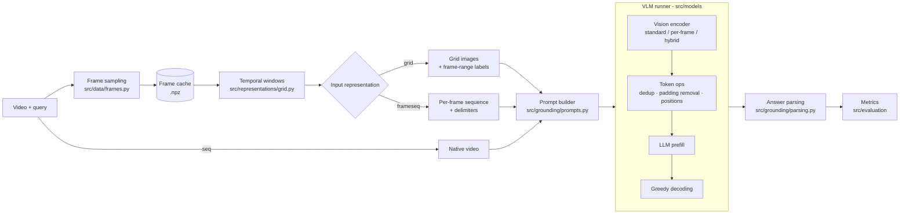
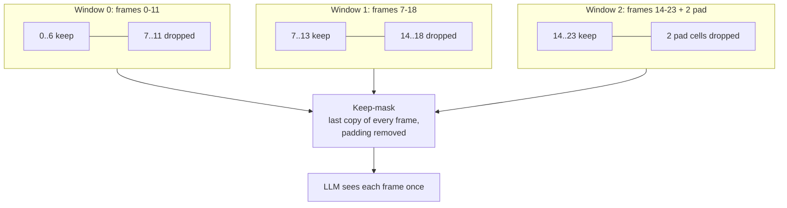
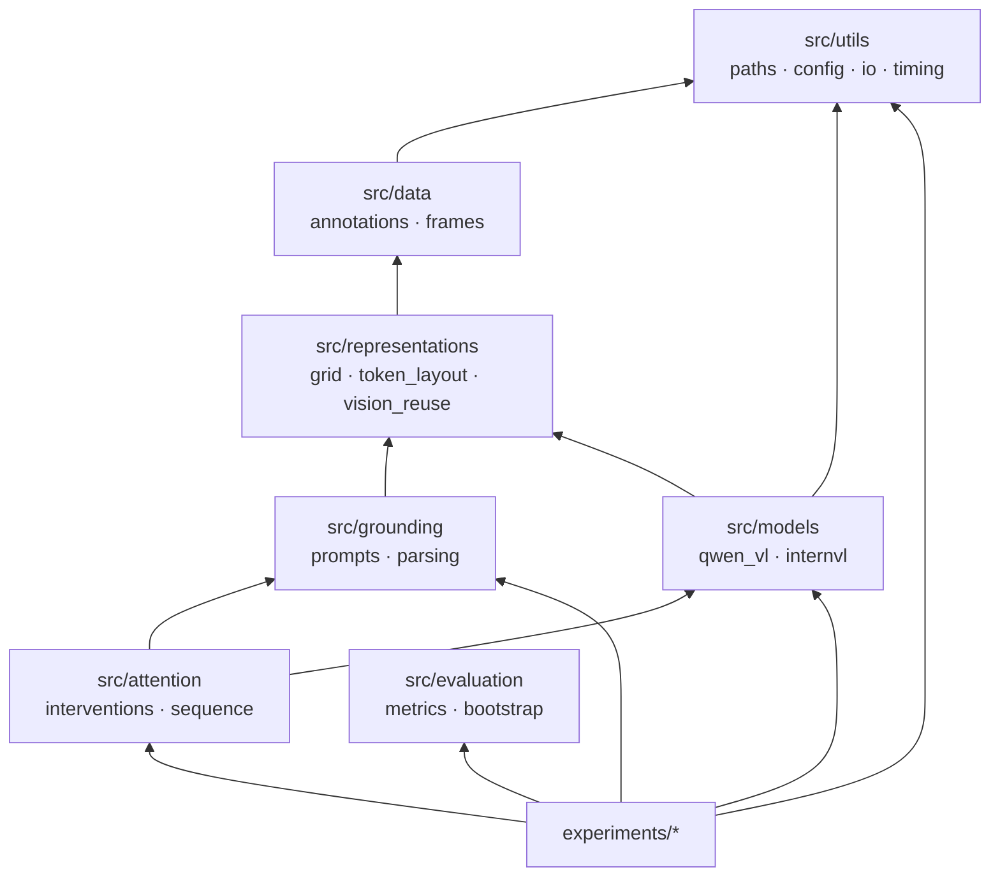

# VLM Temporal Grounding

Training-free video temporal grounding with vision-language models (VLMs). Given a video and a
natural-language query, a VLM returns the start and end of the matching moment. This repository
studies how to arrange the sampled frames as visual tokens: native video input, temporal windows
tiled into grid images, per-frame sequences, deduplicated token layouts, and representations with
or without the delimiter tokens a model places between frames.

Supported models: **Qwen2-VL**, **Qwen2.5-VL**, **Qwen3-VL** (incl. DeepStack features) and
**InternVL3.5**. Datasets in the Charades-STA / ActivityNet Captions annotation format.

## Highlights

- **Temporal windowing**: sliding windows of `cols x rows` frames with configurable stride (overlap)
  and padding of the last partial window.
- **Temporal-to-spatial grids**: each window is composed into one grid image with frame-range labels.
- **Per-frame encoding**: every unique frame is encoded once and its tokens are scattered into the
  grid cells of all windows that contain it, so overlapping windows cost no extra vision compute.
- **Token deduplication**: keep each frame only at its first, last or most central copy, and drop
  black padding cells, before the LLM.
- **Delimiter-aware representations**: per-frame sequences with the model's inter-frame delimiter
  tokens, with the delimiters replaced by neutral tokens, or removed while positions are kept.
- **Causal attention interventions**: attention masks, embedding replacement and value scaling on
  the delimiter tokens, with CPU tests that check masking is equivalent to deletion.
- **Evaluation**: answer parsing, IoU, Recall@{0.3, 0.5, 0.7}, mIoU, paired (optionally
  video-clustered) bootstrap confidence intervals, and stage-wise latency and memory.

## Architecture

### Pipeline



### Visual-token organization

Overlapping windows repeat frames (example: 24 frames, 12-frame windows, stride 7). Frames are encoded once,
placed into their cells, and repeated copies and padding are dropped before the LLM, while the kept
tokens keep their grid positions.



### Module dependencies



### Repository layout

```text
src/
  data/             annotation loading, deterministic subsets, frame sampling and caching
  representations/  temporal windows and grids, token keep-masks / positions, per-frame encoding
  models/           Qwen-VL and InternVL runners with separately timed vision / prefill / decode
  grounding/        prompt construction (grid, per-frame, native video) and answer parsing
  evaluation/       IoU, Recall@IoU, mIoU, paired bootstrap
  attention/        delimiter interventions (masks, replacement, value scaling)
  utils/            portable paths, YAML configs, resumable JSONL output, timing
experiments/
  extract_frames.py          decode and cache frames once per video
  run_grounding.py           evaluation on Qwen-VL models (all representations)
  run_grounding_internvl.py  evaluation on InternVL3.5
  benchmark_latency.py       isolated latency / memory benchmark
  summarize.py               metrics per run + summary table
  paired_bootstrap.py        confidence intervals for differences between runs
  attention/                 causal interventions and attention-mass analysis
configs/                     method configs, baselines/ and ablations/
tests/                       CPU unit tests
```

## Installation

```bash
git clone https://github.com/its-sina/vlm-temporal-grounding.git
cd vlm-temporal-grounding
pip install -r requirements.txt
pip install flash-attn --no-build-isolation   # GPU inference
```

Tested with Python 3.10, PyTorch 2.6 and Transformers 4.57.

## Data

Annotations use the Charades-STA / ActivityNet Captions JSON format:

```json
{"VIDEO_ID": {"duration": 30.96, "timestamps": [[1.2, 7.9]], "sentences": ["person opens a door."]}}
```

By default data is read from `data/<dataset>/annotations/<split>.json` and
`data/<dataset>/videos/`. Override with `--annotations`, `--video-dir`, `--data-dir`, or the
environment variables `VTG_DATA_DIR`, `VTG_CACHE_DIR` and `VTG_RESULTS_DIR`. Models are given as
Hugging Face Hub ids or local directories (`--model`).

## Usage

```bash
# 1. decode frames once (lossless cache, reused by every method)
python experiments/extract_frames.py --dataset charades --split test --fps 1.0 --thumb 336

# 2. evaluate a representation (any config value can be overridden on the command line)
python experiments/run_grounding.py --config configs/baselines/t2sgrid_qwen2vl_charades.yaml --exp grid_s7
python experiments/run_grounding.py --config configs/dedup_grid_qwen2vl_charades.yaml --exp dedup_grid
python experiments/run_grounding.py --config configs/ablations/frameseq_delimiters_qwen2vl.yaml --exp frameseq

# shard across GPUs (runs are resumable)
CUDA_VISIBLE_DEVICES=0 python experiments/run_grounding.py --config ... --exp run --shard 0/2 &
CUDA_VISIBLE_DEVICES=1 python experiments/run_grounding.py --config ... --exp run --shard 1/2 &

# 3. aggregate and compare
python experiments/summarize.py
python experiments/paired_bootstrap.py dedup_grid grid_s7 --cluster-by-video

# attention interventions on the inter-frame delimiters
python experiments/attention/causal_attention.py --model-kind qwen2 --prefix causal_q2 --n 500 \
    --conds A,A_nodelim,Rsp,V0.5
```

### Methods (`--method`)

| Method | Input to the model |
|---|---|
| `seq` | native video |
| `full` | grid images, standard joint vision encoding |
| `iso` | grid layout, every unique frame encoded on its own |
| `hybrid` | first `--depth` ViT blocks per frame, remaining blocks per grid (Qwen2-VL) |
| `frameseq` | each frame its own image, shown once, with delimiter tokens between frames |
| `bbridge` | non-overlapping grids plus bridging grids at window boundaries |
| `+dedup` | drop repeated frame copies (`--dedup first\|last\|center`, `+pad` drops padding) |

Further options: `--pos` (position layouts: `grid`, `flatcells`, `cellmajor`, `cellmajor_gap`),
`--sep neutral` (delimiters replaced by newline tokens), `--labels frames` and `--prompt mo`
(time-based labels and questions).

Each run writes `results/<exp>/pred_shard*.jsonl` (answer, parsed span, IoU, token counts, stage
timings, peak memory) and `config.json`.

## Tests

```bash
pytest
```

All tests run on CPU without model weights. One optional test compares stacked frame preprocessing
against the image processor; it runs when `VTG_QWEN2VL_PROCESSOR` points to a local Qwen2-VL
checkpoint.

## Acknowledgements

The grid input format, prompts and answer-parsing conventions follow the
[T2SGrid](https://github.com/chaohongguo/T2SGrid) evaluation protocol so that results are directly
comparable.

## License

MIT
